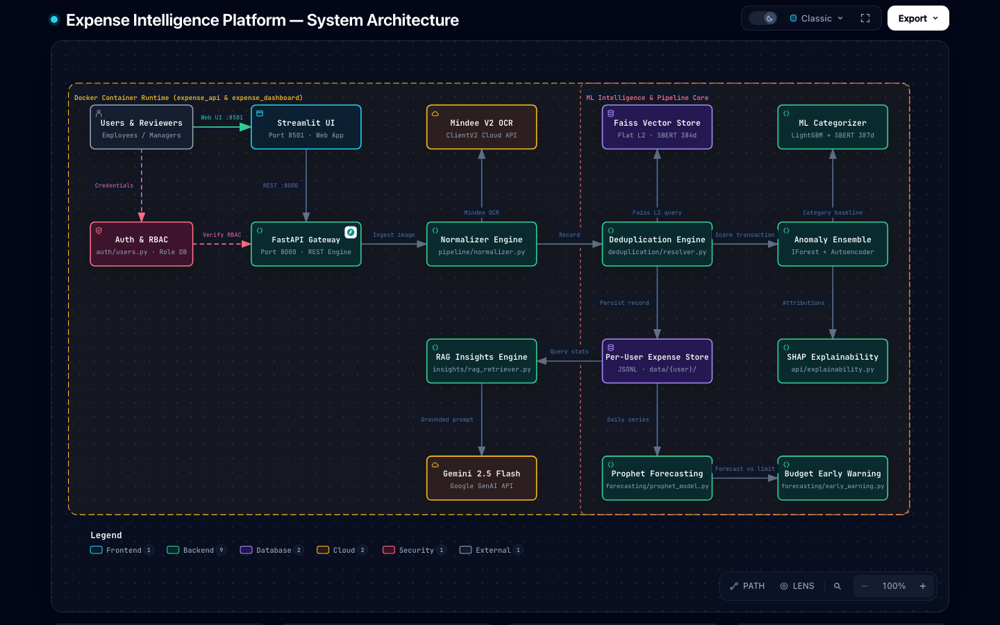

# 💸 Expense Intelligence System

A user-centric expense intelligence platform with OCR, ML-based categorization, personalized anomaly detection, Prophet forecasting, RAG-powered AI insights, and a Streamlit dashboard.

---

## Architecture



> 🔍 **Interactive Architecture Diagram:** Open [`architecture.html`](./architecture.html) in your browser to explore the interactive visual with path tracing, dark/light modes, sub-graph focus, and high-res exports (generated via [Archify](https://github.com/tt-a1i/archify)).

```
Receipt Image
      │
      ▼
┌─────────────┐     ┌──────────────┐     ┌──────────────────┐
│ OCR (Mindee)│────▶│ Normalizer   │────▶│ Dedup Detector   │
└─────────────┘     └──────────────┘     └──────────────────┘
                                                │
                                                ▼
┌────────────────┐   ┌──────────────┐   ┌──────────────────┐
│ Budget Alerts  │◀──│ Anomaly Det. │◀──│ Expense Store    │
│ (Prophet)      │   │ (IF + AE)    │   │ (JSONL flat-file)│
└────────────────┘   └──────────────┘   └──────────────────┘
        │
        ▼
┌─────────────────────────────────────────┐
│  FastAPI Backend (port 8000)            │
│  + Streamlit Dashboard (port 8501)      │
│  + Gemini 2.5 Flash AI Insights (RAG)  │
└─────────────────────────────────────────┘
```

---

## Quick Start (Local)

### 1. Install dependencies

```bash
python -m venv venv
venv\Scripts\activate          # Windows
pip install -r requirements.txt
pip install fastapi "uvicorn[standard]" python-multipart streamlit plotly requests shap
```

### 2. Set API keys

Create a `.env` file in the project root:

```env
MINDEE_API_KEY=your_mindee_key_here
GOOGLE_API_KEY=your_gemini_key_here
```

### 3. Run the API

```bash
uvicorn api.main:app --reload --port 8000
```

API docs available at: http://localhost:8000/docs

### 4. Run the Dashboard

```bash
streamlit run dashboard/app.py
```

Dashboard at: http://localhost:8501

---

## Quick Start (Docker)

```bash
docker-compose up --build
```

- API: http://localhost:8000/docs
- Dashboard: http://localhost:8501

---

## API Reference

### Upload Receipt
```bash
curl -X POST http://localhost:8000/receipts/upload \
  -F "file=@receipt.jpg" \
  -F "user_id=user_001"
```

### List Expenses
```bash
curl "http://localhost:8000/users/user_001/expenses?category=food&date_from=2026-03-01"
```

### Dashboard KPIs
```bash
curl http://localhost:8000/users/user_001/dashboard
```

### AI Insight (Weekly Summary)
```bash
curl http://localhost:8000/users/user_001/insights/weekly_summary
```

### AI Insight (Vendor)
```bash
curl "http://localhost:8000/users/user_001/insights/vendor_insight?vendor=Swiggy"
```

### Set Budget
```bash
curl -X POST http://localhost:8000/users/user_001/budgets \
  -H "Content-Type: application/json" \
  -d '{"category": "food", "monthly_limit": 15000}'
```

### Get Anomalies
```bash
curl http://localhost:8000/users/user_001/anomalies
```

### 30-Day Forecast
```bash
curl http://localhost:8000/users/user_001/forecast/food
```

### Review Queue
```bash
curl http://localhost:8000/users/user_001/review_queue
```

### Approve Flagged Expense
```bash
curl -X POST "http://localhost:8000/users/user_001/review/{expense_id}?action=approve"
```

### Anomaly Explanation (SHAP)
```bash
curl http://localhost:8000/users/user_001/explain/anomaly/{expense_id}
```

### Categorization Explanation (SHAP)
```bash
curl http://localhost:8000/users/user_001/explain/category/{expense_id}
```

---

## Module Map

| Module | Purpose |
|---|---|
| `ocr_extractor.py` | Mindee V2 OCR |
| `pipeline/ingest.py` | End-to-end receipt pipeline |
| `pipeline/normalizer.py` | Raw JSON → ExpenseRecord |
| `models/expense.py` | Pydantic ExpenseRecord |
| `storage/expense_store.py` | JSONL flat-file per user |
| `deduplication/` | Exact + fuzzy (SBERT + Faiss) dedup |
| `categorization/` | LightGBM category classifier |
| `anomaly/` | Isolation Forest + Autoencoder ensemble |
| `forecasting/` | Prophet per-category forecasting |
| `insights/` | Gemini 2.5 Flash RAG insight generation |
| `api/main.py` | FastAPI REST API |
| `api/schemas.py` | Pydantic response models |
| `api/explainability.py` | SHAP feature attributions |
| `dashboard/app.py` | Streamlit 4-page dashboard |

---

## Data Layout

```
data/
└── {user_id}/
    ├── expenses.jsonl       # All expense records
    ├── anomaly_log.jsonl    # Detected anomalies
    ├── budgets.json         # Per-category budgets
    ├── insight_cache.jsonl  # Cached LLM responses (24h TTL)
    ├── insight_store.jsonl  # RAG vector store
    ├── faiss.index          # Dedup vector index
    └── index_map.json       # Faiss ID -> receipt_id map
```

---

## Dashboard Pages

| Page | Content |
|---|---|
| **Overview** | Total spend KPIs, category bar + donut chart, top vendors, AI weekly summary |
| **Anomalies** | Flagged transactions, SHAP contribution chart, confirm/dismiss buttons |
| **Forecasts** | Prophet 30-day line chart with confidence bands, budget progress bars |
| **Review Queue** | Low-confidence + duplicate-flagged receipts, approve/reject/explain |
